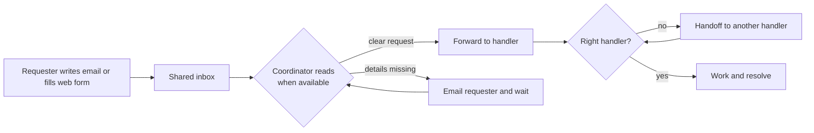

# 2. Current-state process

> **Status: simulated.** The process is a plausible design for a small office, written to support the case study.

## Process map

## Pain points

| # | Pain point | Effect | Evidence in this case study |
|---|---|---|---|
| P1 | No triage order: the inbox is first-in, first-out | Safety requests can wait behind routine ones | Simulated baseline: 6 of 27 safety requests first touched after more than 2 hours |
| P2 | Free-text email has no required fields | Coordinators chase missing details | About 20% of requests need an information follow-up (simulated) |
| P3 | Messages often contain two requests | One part is routed, the other is forgotten or handed off | Multi-request messages cause most silent misroutes in the rules evaluation |
| P4 | Drop-down category is chosen by the requester | About one in five web-form categories is wrong (assumption) | Built into the synthetic data |
| P5 | No reporting | Volumes and delays are invisible | Baseline has to be reconstructed from an event log |

## Roles

| Role | Responsibility today |
|---|---|
| Requester | Writes the request |
| Coordinator (rota) | Reads, routes, chases missing information |
| Handlers | Resolve requests of their type |
| Safety focal point | Handles safety and security concerns |
| HR officer | Handles contract and personal matters |
