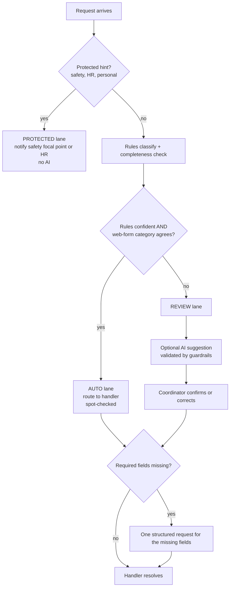

# 4. Future-state workflow

> **Status: proposed design.** Not implemented in any organisation.

## Design principles

1. **Fix the process before adding AI.** Structured intake and simple rules address the main delays.
2. **Protect sensitive requests by design.** Safety and personal matters go to a person, every time, without passing through an AI service.
3. **Prefer an honest "I don't know".** Rules and AI may abstain. An abstention goes to a person; a confident wrong answer goes nowhere.
4. **Suggest, don't apply.** During the pilot, AI suggestions are pre-filled for a coordinator to confirm.

## Process map

## Changes and the pain points they address

| Change | Addresses | Needs AI? |
|---|---|---|
| Web form with required fields per category | P2 missing information | No |
| "One request per submission" guidance and a split option | P3 multi-request messages | No |
| Protected lane with immediate notification | P1 safety delay | No |
| Rules plus form agreement for AUTO routing (Policy B) | Coordinator effort | No |
| AI suggestion for the REVIEW lane | Coordinator effort on unclear requests | Yes, optional |
| Weekly dashboard from the event log | P5 visibility | No |

## Two routing policies

The rules evaluation compares two ways of using the rules:

- **Policy A:** the rules route any request they can classify. On the held-out data this made 17 silent misroutes out of 214 auto-routed requests.
- **Policy B:** the rules route a request only when the web-form category agrees. Email requests have no form category, so they always go to REVIEW. This auto-routed fewer requests (68 of 311) and made no silent misroutes on this data; see the [evaluation limits](06-evaluation-framework.md#how-to-read-these-figures) for why that figure is optimistic.

I recommend Policy B. A slower correct process is better than a fast one that loses requests without anyone noticing.
