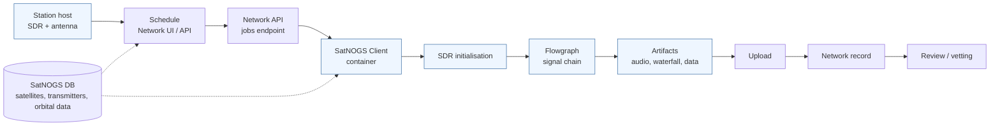

# SatNOGS Ground Station — Risk-Based End-to-End QA Strategy

A portfolio edition of the QA method I used to test a real [SatNOGS](https://satnogs.org) ground station end to end: from scheduling an observation on the SatNOGS Network to the uploaded artifacts being reviewed.

> **What this is.** A methodology case study based on my professional QA work on SatNOGS. It explains how the testing was scoped, ordered, evidenced and reported, and what could be automated next.
>
> **Context.** I worked at Libre Space Foundation as an end-to-end QA engineer for SatNOGS ground-station software from January to October 2026. The testing described here was part of that work and was carried out by me on a station I own. Formal SatNOGS test cases and issues are maintained by LSF on GitLab and are not reproduced here.
>
> **What this is not.** It is not official Libre Space Foundation (LSF) documentation, not the formal LSF test suite, and not a statement about the quality of SatNOGS. LSF has not reviewed or endorsed this repository. SatNOGS is a Libre Space Foundation project; I do not own or maintain it.
>
> **What was left out.** Raw execution logs, observation-level evidence, station configuration records, and every observation that was not formally resolved with the maintainers. Where one of those observations taught a general testing lesson, the lesson is written here as a generic example without describing the original issue.

## The problem

A SatNOGS observation crosses components owned by different people: the web Network, the satellite database, a client running on volunteer hardware, a software-defined radio (SDR), GNU Radio flowgraphs and an upload path back to the Network. When anything breaks, the station owner usually sees the same symptom: *the observation didn't work*.

The QA goal was to make failures **visible, reproducible and attributable to a component**, without putting a live station or real satellite passes at unnecessary risk.

## The system and its boundaries

Blue components run on the station; the rest are shared services. Details and typical failure symptoms per component: [docs/02-system-under-test.md](docs/02-system-under-test.md).

## How the work is organised

| Document | What it shows |
|---|---|
| [01 — QA strategy](docs/01-qa-strategy.md) | Goals, scope, test levels and definition of done |
| [02 — System under test](docs/02-system-under-test.md) | Components, interfaces and where each one can fail |
| [03 — Risk-based execution](docs/03-risk-based-execution.md) | 16 test areas and a run order based on station impact, with gates |
| [04 — Evidence standard](docs/04-evidence-standard.md) | Evidence classes, status vocabulary and recording rules |
| [05 — End-to-end test design](docs/05-end-to-end-test-design.md) | Three E2E scenarios and the reasoning behind each design choice |
| [06 — Release regression method](docs/06-release-regression-method.md) | Baseline-first regression for a client and flowgraph upgrade |
| [07 — Automation roadmap](docs/07-automation-roadmap.md) | What can and cannot be automated, in stages |
| [08 — Lessons learned](docs/08-lessons-learned.md) | Generic lessons, including those from unresolved observations |
| [templates/](templates/) | Test-case, defect-report and run-log templates |

## What was done, and at what level of evidence

| Item | Status | Basis |
|---|---|---|
| Test strategy, 16-area model and impact-ordered run plan | Planned in a Master QA Plan (see [Provenance](#provenance-and-licence)) and applied | The plan and my working record |
| Area-based functional scenarios | Executed on my own station, autumn 2026 | My working record; individual results not published here |
| Three end-to-end scenarios (clean pass, network interruption, SDR unavailable then recovery) | Executed; each met its stated pass criteria and each recorded limitations | My working record; see [05](docs/05-end-to-end-test-design.md) |
| Release regression, SatNOGS Client 2.1.2 → 2.1.4 and flowgraphs 2.6 → 2.7 | Executed once, 14–17 October 2026, on one station | My working record; see [06](docs/06-release-regression-method.md) |
| Automation stages 1–4 | **Proposed, not built** | [07](docs/07-automation-roadmap.md) |

These results come from **one station, one operator and one period**. They do not certify a release, do not validate every signal-processing path (no frames were decoded from a real signal during the work), and do not demonstrate the reliability of SatNOGS as a whole.

## Skills this project demonstrates

- Risk-based test planning and impact-ordered execution
- End-to-end, failure-recovery and regression testing of a distributed system
- Controlled fault injection with explicit approval gates and clean-up
- Evidence discipline: separating what was measured, observed, reported and inferred
- Linux, Docker and REST API diagnostics; log analysis
- Writing for two audiences: precise procedures for testers, short summaries for decision-makers

## Provenance and licence

| Element | How it came about |
|---|---|
| Test execution, observations, evidence recording and the regression run | Carried out by me on my own station, as part of my QA role at LSF |
| Master QA Plan (16 test areas, 11-item regression suite, status lifecycle, run order) | I developed the plan's overall risk-based structure and organisation, including the 16 test areas and the regression approach, from my testing knowledge, work, observations and decisions. It was informed by the existing SatNOGS/LSF project context and the formal test cases in LSF GitLab. AI assisted with drafting, structuring, consolidation and refinement. The plan itself is not published here |
| This portfolio edition | A new, generalised write-up drafted and restructured with AI assistance from my material and instructions. I am responsible for its content |
| Automation roadmap | Proposed, not built |

The AI tool did not carry out any of the testing described here. Public SatNOGS documentation and upstream issue trackers are cited by link only; no third-party text or diagrams are copied. Licensing for this repository is described in the [top-level README](../../README.md#licence).
