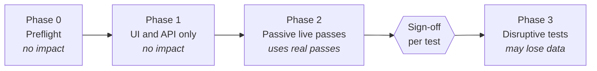

# 03 — Risk-based execution

## Test areas

The 16 areas mirror the components in [02](02-system-under-test.md). Area numbers are for lookup only; they are **not** the execution order.

| Area | Name | Main risk it addresses |
|---|---|---|
| 1 | Network: authentication and user management | Owner cannot use the service |
| 2 | Ground station management | Station misconfigured or not schedulable |
| 3 | Observation scheduling | Work is planned incorrectly or not at all |
| 4 | Observation lifecycle | Scheduled work does not run end to end |
| 5 | Vetting and quality control | Results cannot be reviewed reliably |
| 6 | Permissions and access control | Users can do more, or less, than intended |
| 7 | Network API | Integrations receive wrong or unclear responses |
| 8 | Pass prediction and orbital data | Passes are predicted at the wrong time |
| 9 | SatNOGS Client | The station-side scheduler misbehaves |
| 10 | SDR and hardware integration | Radio not opened or configured correctly |
| 11 | Signal processing (gr-satnogs) | Investigation area; no separate pass/fail scenarios |
| 12 | Flowgraph execution | Signal chain does not run for the whole pass |
| 13 | Data upload and artifacts | Data is lost between station and Network |
| 14 | SatNOGS DB: satellite and transmitter data | Reference data is stale or inconsistent |
| 15 | Installation and setup | Station cannot be (re)built reliably |
| 16 | Error handling and recovery | Failures are silent, misleading or cause data loss |

## Run order by station impact

| Phase | What runs | Station impact |
|---|---|---|
| 0 | Preflight: smoke test, connectivity baseline, check for leftover configuration backups, credential hygiene | None |
| 1 | UI and API checks: authentication, station management, scheduling rejections, permissions, API behaviour, pass prediction, DB data | None; rejection tests create nothing |
| 2 | Passive capture of real passes, scheduled well ahead, with nothing touched during the pass | Consumes real passes |
| 3 | Disruptive tests, least to most harmful: disposable containers → idle restarts and configuration cycles → station state changes → faults injected during a pass | Interrupts the client or loses data |

## Gates

| Gate | Rule | Why |
|---|---|---|
| Lead time | A live-pass test is scheduled at least 15 minutes ahead | Time to verify preconditions and abort cleanly |
| Configuration buffer | A configuration change must finish at least 10 minutes before the next pass | A restart during a pass would invalidate an unrelated observation |
| Abort | Abort if less than 5 minutes remain before the window | Prevents rushed, unverified fault injection |
| Sign-off | Every Phase 3 test is approved individually | Disruptive tests consume scarce passes and can lose data |

## Pass budget

Real satellite passes are the scarcest resource. The plan counts them explicitly: each mid-pass fault needs its own dedicated pass, while passive Phase 2 scenarios can share a small number of observations. Budgeting passes up front prevents the most expensive tests from being squeezed in at the end.

## Overlap rules

- Some scenarios evidence the same behaviour. They are cross-referenced but **never merged**.
- When two scenarios disagree, the contradiction is recorded and **both results are kept** with their evidence. A contradiction is a result, not an inconvenience.

## How results are reported

Results are summarised by status and evidence class (see [04](04-evidence-standard.md)), with `NOT RECORDED`, `BLOCKED` and `INCONCLUSIVE` reported separately from `PASS` and `FAIL`. Individual results from the original execution are kept in my private working record and are not published here.
