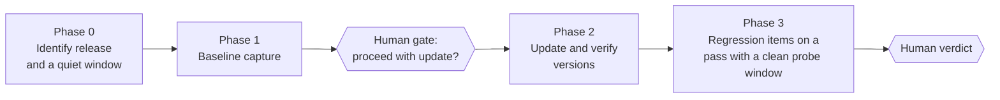

# 06 — Release regression method

A new release can break something that used to work. A regression suite checks the **critical path** in about a day, against a baseline captured **before** the update. Without a baseline, a post-update measurement has nothing to be compared with.

## Worked example

The method was executed once, on one station, from 14 to 17 October 2026:

| Component | Before | After |
|---|---|---|
| SatNOGS Client | 2.1.2 | 2.1.4 |
| satnogs-flowgraphs | 2.6 | 2.7 |
| Other station components | — | unchanged |

## Procedure

1. **Phase 0: identify the release and a quiet window.** Read the release announcement, record the component versions, and confirm no observation is scheduled during the update.
2. **Phase 1: baseline.** Hashed version snapshot, saved client log, station page screenshot, private configuration backup, connectivity probe running, one reference pass with the flowgraph recorded.
3. **Phase 2: update.** Run the standard setup tool in a session that survives disconnection, change no settings, save the run record, verify the containers and compare the post-update snapshot with the baseline.
4. **Phase 3: regression items** on a pass whose window has a clean connectivity probe.

## The 11-item suite

| # | Item | What it protects |
|---|---|---|
| 1 | Authentication | Users can sign in and use the Network |
| 2 | Station readiness / heartbeat | The Network sees the station as usable |
| 3 | Schedule an observation | An observation can be planned |
| 4 | Client retrieves the job | Scheduled work starts on time |
| 5 | SDR initialises | The radio is opened and configured |
| 6 | Flowgraph executes | The signal chain runs for the whole pass |
| 7 | Artifacts generated | Audio and waterfall exist and are valid |
| 8 | Upload succeeds | Artifacts reach the Network |
| 9 | Record appears and can be reviewed | The record is complete and vettable |
| 10 | Recovery | A Network interruption does not lose data |
| 11 | Full end-to-end pass | The whole chain works together |

## Outcome of the worked example

All 11 items were recorded as passed, three of them with qualifications. Item 6 had limited evidence, because the flowgraph name was not captured after the update. Item 10 was evidenced by a natural, uncontrolled outage rather than a controlled one, which is weaker evidence. Item 11 passed with recorded caveats (limited evidence for some steps, and no signal decoded).

This outcome describes one update on one station. It is **not** a certification of the release.

## What a baseline looks like

These are the kinds of measures captured before the update, so that the same measures after the update can be compared. Values are from one station and one period and are **not** reference values for other stations.

| Measure | Example baseline | Why it matters |
|---|---|---|
| Client start relative to scheduled start | About +1.7 s | Detects scheduling drift |
| SDR open → stream start | About 1 s | Detects slow or failing radio initialisation |
| Waterfall file size for a given mode | About 1.6–1.7 MB | Detects truncated captures |
| Time until artifacts appear on the Network after pass end | A few minutes | Detects upload delays |
| Client log content on success | Quiet at default level | Unexpected output is a signal in itself |

Baselines must be taken **per mode**: an expectation derived from one modulation type did not apply to another.

## Lessons from the run

- Verify the installed version on the host; a public status page may show the new version only after the next observation.
- Re-creating a container during an observation aborts it. Check the upcoming passes before updating.
- Broad log searches such as "error" produce false positives (for example, package descriptions that mention *error correction*). Use specific patterns.
- On an intermittent uplink, most of the probe window can be invalid. That is the environment, not the release, and it is exactly why the validity gate exists.
